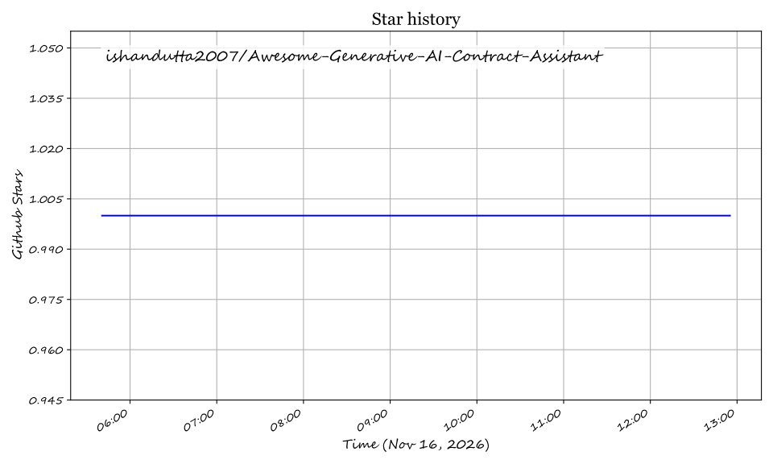

# Awesome-Generative-AI-Contract-Assistant ⚖️ ⚡

  
  
  
  
  
  
  

### 📚 Curated List of Enterprise SaaS Platforms & Open-Source GitHub Projects
*Focused on Contract Drafting, Automated Redlining, Clause Intelligence & Self-Hosted Legal AI Reasoning Engines*  
**Last updated: March 2026**

---

## 📖 Table of Contents
- [📌 Sector Overview & Market Dynamics](#-sector-overview--market-dynamics)
- [🏢 SaaS / Hosted Platforms](#-saas--hosted-platforms)
- [🔓 Open-Source GitHub Projects](#-open-source-github-projects)
- [🛠️ Architecture & Build Frameworks](#-architecture--build-frameworks)
- [🤝 How to Contribute](#-how-to-contribute)
- [⚠️ Disclaimer](#️-disclaimer)
- [💖 Support](#-support)
- [📈 Star History](#-star-history)

---

## 📌 Sector Overview & Market Dynamics

The global Legal AI and Contract Lifecycle Management (CLM) software market is estimated at **$3.3B to $4.0B in 2025–2026**, expanding rapidly at an 8%–25% CAGR toward a projected $11B+ by the early 2030s. The sector remains **highly fragmented**: legacy legal software conglomerates (such as Thomson Reuters and RELX/LexisNexis) and enterprise CLM providers (like Icertis and Ironclad) hold substantial corporate footprints, while no single vendor commands more than ~15% market share as hundreds of specialized generative AI point solutions and self-hosted open-source legal agents fiercely compete for legal ops, procurement, and transactional law firm workloads.

---

## 🏢 SaaS / Hosted Platforms

Below is a curated comparison of leading commercial Generative AI contract assistants, sorted in descending order by company valuation / scale.

| Product | Company Size (Valuation / Revenue) | Description | Pricing (Starting Tier) | Free Tier / Free Trial Limits |
|:---|:---|:---|:---|:---|
| **[Harvey AI](https://www.harvey.ai/)** 🚀 | **$15.5B Valuation** (~$400M ARR; raised $550M Series D) | Enterprise legal AI copilot; dispatches complex contract review, drafting, diligence, and multi-step legal research across parallel specialized agents with verified citations. | **~$1,000 / seat / month** (~$12,000/yr per seat; enterprise annual agreements only) | **No free tier & no self-serve free trial** (Sales demo and pilot evaluations only upon qualification) |
| **[Icertis Vera Copilot](https://www.icertis.com/)** 🏛️ | **$5.0B Valuation** (~$300M+ ARR; SoftBank-backed) | Enterprise Contract Lifecycle Management (CLM) with autonomous Vera AI agents for clause summarization, risk scoring, compliance auditing, and contract drafting across massive multi-thousand document portfolios. | **$50,000 / year** (~$4,166/mo base platform fee; scales to $100K–$300K+ with modules & implementation) | **No free tier & no open free trial** (Custom guided sales demo / proof-of-concept for qualified enterprises) |
| **[Ironclad AI Assist](https://ironcladapp.com/)** ⚡ | **$3.2B Valuation** (~$200M+ ARR; raised $334M) | Cloud CLM platform featuring AI Assist and Jurist agent for playbook-governed contract review, redline generation, automated approvals, and digital repository analytics. | **$50,000 / year** (Effective rate ~$150–$350/seat/mo; based on contract volume and seats) | **No free tier & no self-serve free trial** (1-on-1 enterprise sandbox demo through sales) |
| **[Casetext CoCounsel](https://casetext.com/)** ⚖️ | **$650M Acquisition** (Acquired by Thomson Reuters) | GPT-4-powered legal intelligence agent offering CoCounsel Essentials for clause analysis, fast redlining, deposition prep, and deep case research linked to Westlaw. | **$340 / month** per user (CoCounsel Essentials; billed annually; bundled tiers scale to $630–$1,690/mo) | **No free tier** (Sales-assisted 7 to 14-day evaluation trial with restricted document upload quotas) |
| **[Spellbook](https://www.spellbook.legal/)** 🪄 | **$350M Valuation** (Tracking toward $100M ARR; raised $120M) | AI transactional copilot operating inside Microsoft Word; automates clause drafting, aggressive/moderate redlining, missing clause detection, and contract reviews. | **$100 / user / month** (Starting tier, billed annually; professional team packages range $100–$350/user/mo) | **7-day free trial** (Full feature access within MS Word add-in; expires after 7 days without automatic charge) |
| **[Luminance Lumi](https://www.luminance.com/)** 🔍 | **~$300M–$400M Est. Valuation** (~$165M total raised; £10M–£50M ARR) | Legal-grade conversational AI that analyzes up to 20 documents simultaneously, cross-examining draft versions against precedents, agreements, and negotiation playbooks. | **$43,000 / year** (~$3,580/mo; volume-based document tiers with multi-year commitments) | **No free tier & no public trial** (Private pilot programs granted to enterprise CLM clients on request) |
| **[Robin AI](https://www.robinai.com/)** 🤖 | **~$70M Total Raised** (~$10M ARR) | Legal AI contract review assistant fine-tuned on Anthropic Claude; provides clause-by-clause suggestions, obligation extraction, and rapid playbook adherence checks. | **$0 / month** (Free tier available); Paid Pro plans start at custom quote | **Free forever plan: 10 messages / day** for 1 user with basic contract assistance |

---

## 🔓 Open-Source GitHub Projects

Explore top-tier open-source projects, local-first legal agents, and self-hosted contract intelligence frameworks. Sorted in descending order by GitHub Stars_Count.

| Project | GitHub_Stars | Description |
|:---|:---|:---|
| **[ai-legal-claude](https://github.com/zubair-trabzada/ai-legal-claude)** 🧠 |  | **Comprehensive AI Legal Assistant skill suite.** Powers 14 specialized skills across 5 parallel agents for contract review, risk scoring, NDA generation, compliance verification, and negotiation strategy with automated PDF report generation. |
| **[OpenContracts](https://github.com/Open-Source-Legal/OpenContracts)** 📄 |  | **Open document intelligence platform and DMS for the agentic world.** Features layout-faithful PDF annotations, structured legal data extraction via LLM queries, version-controlled contract corpuses, and human-in-the-loop citation graphs. |
| **[cuad](https://github.com/The-Atticus-Project/cuad)** 🎯 |  | **Contract Understanding Atticus Dataset (NeurIPS).** The canonical foundational legal NLP benchmark containing 13,000+ annotations across 41 contract categories, widely used to train, evaluate, and fine-tune commercial and OSS contract review models. |
| **[claude-legal-skill](https://github.com/evolsb/claude-legal-skill)** ⚖️ |  | **AI-powered contract review skill with CUAD risk detection.** Integrates market benchmarks and lawyer-ready redline generation. Compatible with Claude Code, Cursor, Codex, and 26+ developer agent workflows. |
| **[legal-ai-agent](https://github.com/Paparusi/legal-ai-agent)** 🇻🇳 |  | **Jurisdiction-localized contract review agent.** Evaluates 10 legal risk categories (statutory penalty caps, auto-renewal traps, liability ceilings, force majeure), checks Vietnamese statutory codes with precise article citations, and supplies 8+ baseline contract templates via REST API. |
| **[contract-review](https://github.com/xiaodingfeng/contract-review)** 🌐 |  | **Full-stack web application for contract examination.** Supports multi-format contract uploads, AI pre-analysis, custom review check points, OnlyOffice in-browser document editing, legal knowledge base retrieval, and case law augmentation. |
| **[ContractGuard](https://github.com/he-yufeng/ContractGuard)** 🛡️ |  | **Consumer and small business contract guardian.** AI agent that scans fine print, highlights one-sided or unfair clauses, translates dense legalese into plain English, and flags potential liabilities in seconds. |
| **[ally-legal-assistant](https://github.com/Azure-Samples/ally-legal-assistant)** 💼 |  | **Azure OpenAI Word plugin assistant.** Provides contract clause analysis, real-time interactive Q&A against uploaded agreements, and automated document markup directly inside the Microsoft Word editing environment. |
| **[doc-haus](https://github.com/sure-scale/doc-haus)** 🏠 |  | **Local-first legal AI agent.** Keeps sensitive legal agreements strictly on local storage while exporting review suggestions and redlines as authentic Word tracked changes (DOCX). |
| **[ms-word-addin](https://github.com/Vaquill-AI/ms-word-addin)** 📝 |  | **Open-source Legal AI assistant for Microsoft Word.** Provides a task-pane add-in supporting automated playbook enforcement, drafting assistance, contract comparison, and local legal search. |
| **[legal-redline-tools](https://github.com/evolsb/legal-redline-tools)** 🪶 |  | **Legal deliverable formatting engine.** Generates authentic tracked-changes Word documents (.docx) and side-by-side redline PDFs from arbitrary AI contract review outputs. |
| **[hermes-legal](https://github.com/Lethe044/hermes-legal)** 📜 |  | **Scriptable CLI analyzer with true inline Word redlines.** Features offline regex/heuristic scanning with zero API fees, optional LLM analysis (Ollama, Groq, Gemini), tracked-changes `.docx` output, batch scanning, and webhook alerts for critical risk clauses. |
| **[draft-legal](https://github.com/AniketTati/draft-legal)** 🏗️ |  | **Self-hosted end-to-end CLM platform.** Deploys via `docker compose up` with ~30 legal agent tools, hybrid retrieval (pgvector + Elasticsearch + RRF fusion), interactive redline negotiation cards, and full lifecycle approval/signing pipelines. |

---

## 🛠️ Architecture & Build Frameworks

When engineering private legal AI infrastructure, select the architecture pattern best suited to your organization's security posture and technical requirements:

1. **Complete Self-Hosted CLM**: Choose **[draft-legal](https://github.com/AniketTati/draft-legal)** for full lifecycle management, hybrid vector/keyword search, and undoable write confirmations.
2. **Local-First CLI & Tracked Changes**: Choose **[hermes-legal](https://github.com/Lethe044/hermes-legal)** or **[doc-haus](https://github.com/sure-scale/doc-haus)** to keep documents on-premises while generating native Word `.docx` revisions.
3. **Enterprise Document Mining & Annotations**: Choose **[OpenContracts](https://github.com/Open-Source-Legal/OpenContracts)** for visual PDF annotation layers, citation tracing, and fine-grained data extraction pipelines.
4. **Agent Skills & Playbook Integrations**: Integrate **[ai-legal-claude](https://github.com/zubair-trabzada/ai-legal-claude)** or **[claude-legal-skill](https://github.com/evolsb/claude-legal-skill)** for plug-and-play skills in CLI agents and IDEs.

---

## 🤝 How to Contribute

Contributions are welcome! Please follow these guidelines:

1. 🍴 Fork the repository.
2. 📝 Add or edit entries in [README.md](file:///C:/Users/ishan/Documents/Projects/Awesome-Generative-AI-Contract-Assistant/README.md) following the existing table formatting.
3. 🔍 Ensure all SaaS listings include specific pricing figures, free tier/trial boundaries, and company valuation/revenue metrics.
4. ⭐ For open-source projects, ensure proper GitHub links and stargazer social badges are provided.
5. 🚀 Submit a pull request with a concise summary of additions.

---

## ⚠️ Disclaimer

- This repository is a **community-curated index** provided for informational and research purposes only. It does not constitute formal legal advice.
- Contracts and commercial agreements contain sensitive, confidential, and legally privileged data. Always verify model data retention terms, enforce strict data residency boundaries, and **mandate qualified human attorney review** before executing or signing AI-generated agreements.

---

## 💖 Support

If you find this curated ecosystem directory helpful, please consider supporting the project:

- ⭐ **Star** this repository to help others discover it!
- 🍴 **Fork** and contribute new tools or updates.
- 📢 **Share** with colleagues across legal tech, ops, and engineering communities.
- ☕ **Sponsor & Buy a Coffee**: Support ongoing maintenance via the [GitHub Sponsors Dashboard](https://github.com/sponsors/ishandutta2007).

---

## 📈 Star History

## ⭐ Star History

<a href="https://star-history.com/#ishandutta2007/Awesome-Generative-AI-Contract-Assistant&Timeline" align="center">
  <picture>
    <source media="(prefers-color-scheme: dark)" srcset="assets/ishandutta2007_Awesome-Generative-AI-Contract-Assistant_growth.svg">
    
  </picture>
</a>
